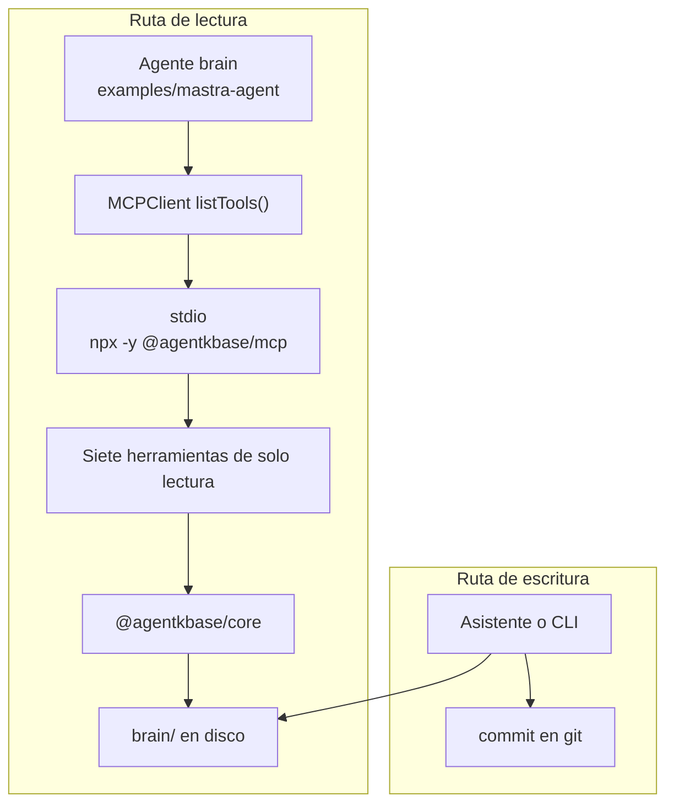
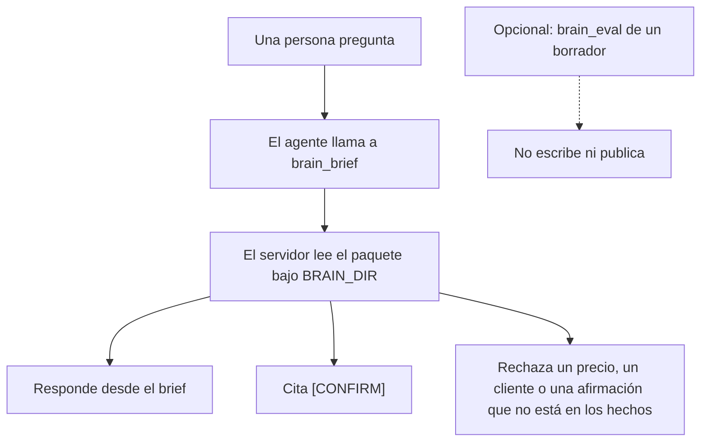
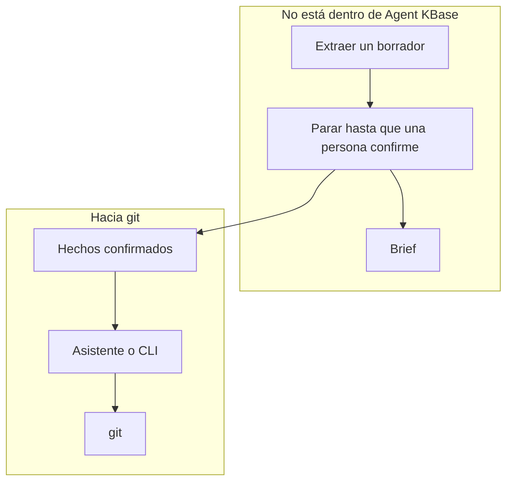

# Mastra y el brain

Agent KBase es la pieza que Mastra no trae: hechos, historias y preguntas abiertas en git, con los huecos marcados `[CONFIRM]`. El `MCPClient` de Mastra habla por stdio. `@agentkbase/mcp` es el adaptador.

La instalación en Cursor se queda como está. Mira [MCP de Agent KBase](10-mcp.md).

## Conectar

El cliente vive junto al agente de Mastra. `BRAIN_DIR` es la raíz del repo que contiene `brain/`.

```ts
import { MCPClient } from "@mastra/mcp";

export const agentkbaseMcp = new MCPClient({
  id: "agentkbase",
  servers: {
    agentkbase: {
      command: "npx",
      args: ["-y", "@agentkbase/mcp"],
      env: { BRAIN_DIR: process.env.BRAIN_DIR! },
    },
  },
});
```

El agente toma esas herramientas y responde desde el brief.

```ts
import { Agent } from "@mastra/core/agent";
import { agentkbaseMcp } from "../mcp/agentkbase";

export const brainAgent = new Agent({
  id: "brain-agent",
  name: "Brain agent",
  instructions: `Answer from the Agent KBase brain.
Call the brief tool before you answer.
Quote a gap as [CONFIRM].
Refuse a price, a client, or a claim that is not in the brief.
Do not write brain/. Do not publish.`,
  model: "openai/gpt-4o-mini",
  tools: await agentkbaseMcp.listTools(),
});
```

El agente lee por estas herramientas. El asistente o la CLI escribe `brain/` y hace el commit. Mastra no guarda el brain.



Una copia de estos archivos está en `examples/mastra-agent/`. Queda fuera del workspace de pnpm.

Desde un checkout de este repositorio, antes de que el paquete esté publicado, apunta `command` a `node` y `args` a `packages/mcp/dist/index.js`.

## Herramientas

Siguen siendo de solo lectura:

| Herramienta | Uso |
|------|-----|
| `brain_brief` | El paquete desde el que el agente debe responder |
| `brain_search` | Encontrar una línea en `brain/` |
| `brain_read` | Leer un archivo dentro de `brain/` |
| `brain_list` | Listar el markdown bajo `brain/` |
| `brain_open_questions` | Lo que una persona aún tiene que confirmar |
| `brain_validate` | Archivos obligatorios y huecos `[CONFIRM]` vacíos |
| `brain_eval` | Un borrador contra `brain/facts`. La comprobación por defecto: precios inventados |

`brain_eval` no escribe `brain/` y no publica.

Una pregunta pasa por `brain_brief`.



## El bucle

`examples/mastra-agent` es ese bucle para una reseña de Google. Lee el brief y luego redacta un borrador o escala. Una reseña tranquila recibe una respuesta corta sacada del brief. Una reseña de 1 o 2 estrellas, una reseña hostil, o una reseña que pide un precio, un cliente o una afirmación que no está en la carpeta, escala, y el hueco se marca `[CONFIRM]`. `brain_eval` comprueba un precio inventado. No escribe ni publica.

El ejemplo puede listar reseñas de Google Business Profile. Publica una respuesta solo después de que una persona ponga `approved: true` en un borrador. Un escalado no se publica. Un borrador sin ese sí no se publica. Si faltan las credenciales de Google, el resultado es `posted: false` y no llama a Google. Google tiene que aprobar el acceso a la Business Profile API para el proyecto de Cloud, y el dueño tiene que conectar la ficha.

`@mastra/core` se queda en ese ejemplo. No entra en `@agentkbase/core`, ni en la CLI, ni en el servidor MCP. En el MCP no hay herramienta de escritura ni de publicación.



Los hechos confirmados pasan por el asistente o la CLI y entran en git. Una respuesta a una reseña sigue en borrador hasta que una persona dice que sí, y ese sí no escribe `brain/`.
