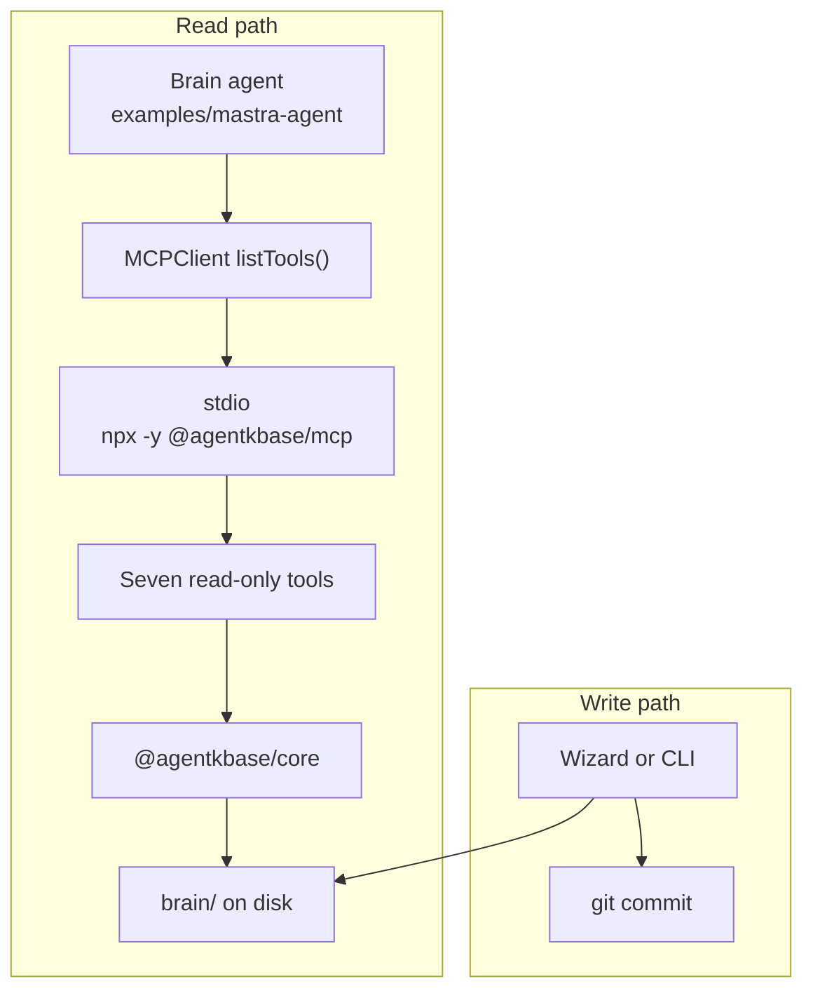
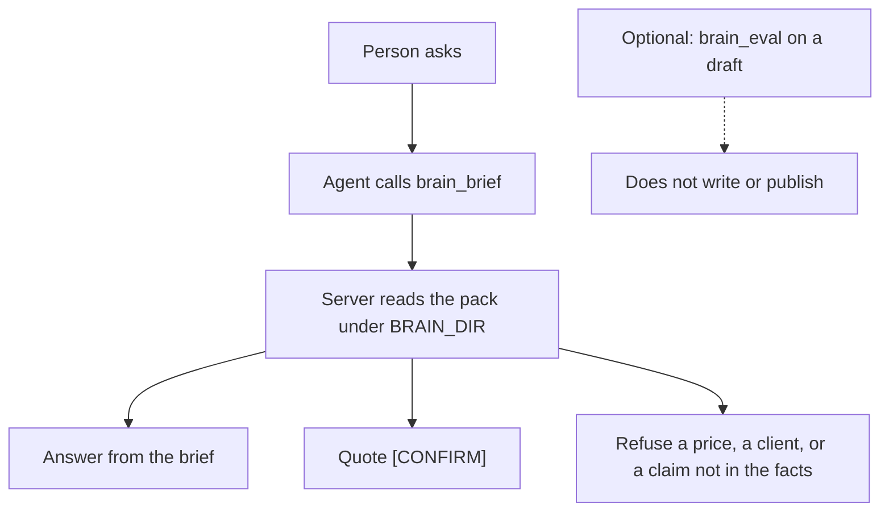
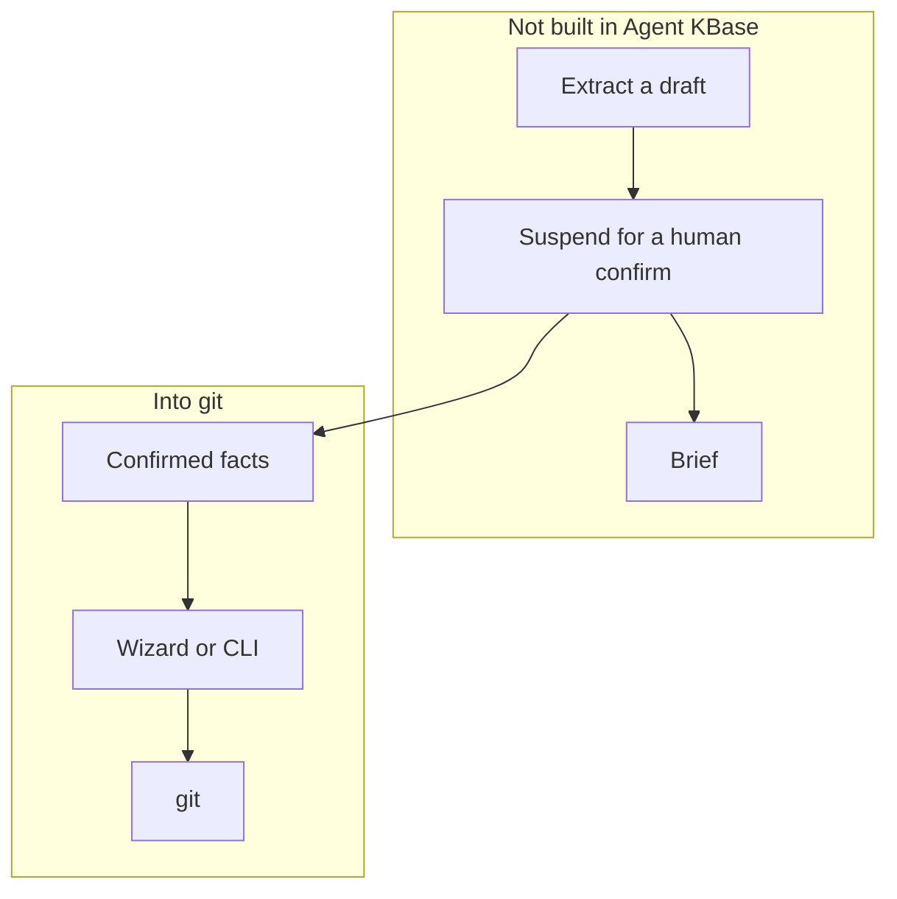

# Mastra and the brain

Agent KBase is the piece Mastra does not ship: facts, stories, and open questions in git, with gaps marked `[CONFIRM]`. Mastra’s `MCPClient` speaks stdio. `@agentkbase/mcp` is the adapter.

Cursor install stays as it is. See [Agent KBase MCP](10-mcp.md).

## Connect

The client lives next to your Mastra agent. `BRAIN_DIR` is the repo root that contains `brain/`.

```ts
import { MCPClient } from "@mastra/mcp";

export const agentkbaseMcp = new MCPClient({
  id: "agentkbase",
  servers: {
    agentkbase: {
      command: "npx",
      args: ["-y", "@agentkbase/mcp"],
      env: { BRAIN_DIR: process.env.BRAIN_DIR! },
    },
  },
});
```

The agent takes those tools and answers from the brief.

```ts
import { Agent } from "@mastra/core/agent";
import { agentkbaseMcp } from "../mcp/agentkbase";

export const brainAgent = new Agent({
  id: "brain-agent",
  name: "Brain agent",
  instructions: `Answer from the Agent KBase brain.
Call the brief tool before you answer.
Quote a gap as [CONFIRM].
Refuse a price, a client, or a claim that is not in the brief.
Do not write brain/. Do not publish.`,
  model: "openai/gpt-4o-mini",
  tools: await agentkbaseMcp.listTools(),
});
```

The agent reads through these tools. The wizard or the CLI writes `brain/` and commits. Mastra does not store the brain.



A working copy of these files is in `examples/mastra-agent/`. It is outside the pnpm workspace.

From a checkout of this repository, before the package is published, point `command` at `node` and `args` at `packages/mcp/dist/index.js`.

## Tools

The tools stay read-only:

| Tool | Use |
|------|-----|
| `brain_brief` | The pack the agent should answer from |
| `brain_search` | Find a line in `brain/` |
| `brain_read` | Read one file inside `brain/` |
| `brain_list` | List markdown under `brain/` |
| `brain_open_questions` | What a human still has to confirm |
| `brain_validate` | Required files and empty `[CONFIRM]` placeholders |
| `brain_eval` | A draft against `brain/facts`. Default check: invented prices |

`brain_eval` does not write `brain/` and does not publish.

One question goes through `brain_brief`.



## The loop

`examples/mastra-agent` is that loop for a Google review. It reads the brief, then drafts or escalates. A calm review gets a short reply from the brief. A 1- or 2-star review, a hostile review, or a review that needs a price, a client, or a claim that is not in the folder escalates, and the gap is marked `[CONFIRM]`. `brain_eval` checks an invented price. It does not write or publish.

The example can list Google Business Profile reviews. It posts a reply only after a person sets `approved: true` on a draft. An escalate is not posted. A draft without that yes is not posted. Missing Google credentials return `posted: false` and do not call Google. Google has to approve Business Profile API access for the Cloud project, and the owner has to connect the location.

`@mastra/core` stays in that example. It does not go inside `@agentkbase/core`, the CLI, or the MCP server. There is no write tool and no publish tool on the MCP server.



Confirmed facts go through the wizard or the CLI into git. A review reply stays a draft until a person says yes, and that yes does not write `brain/`.
