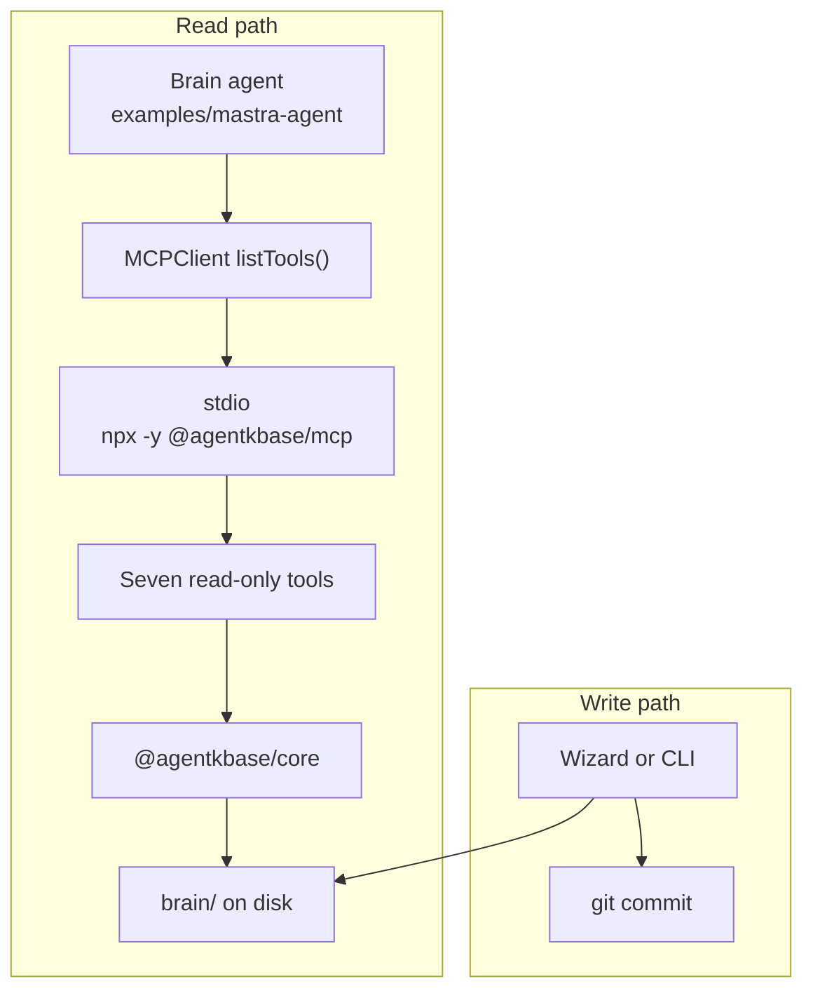
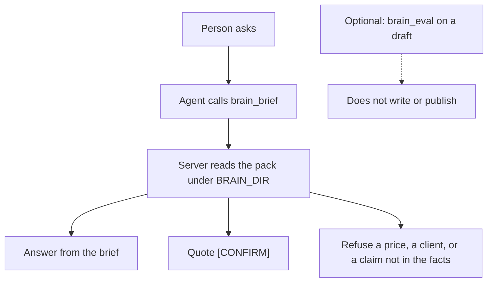
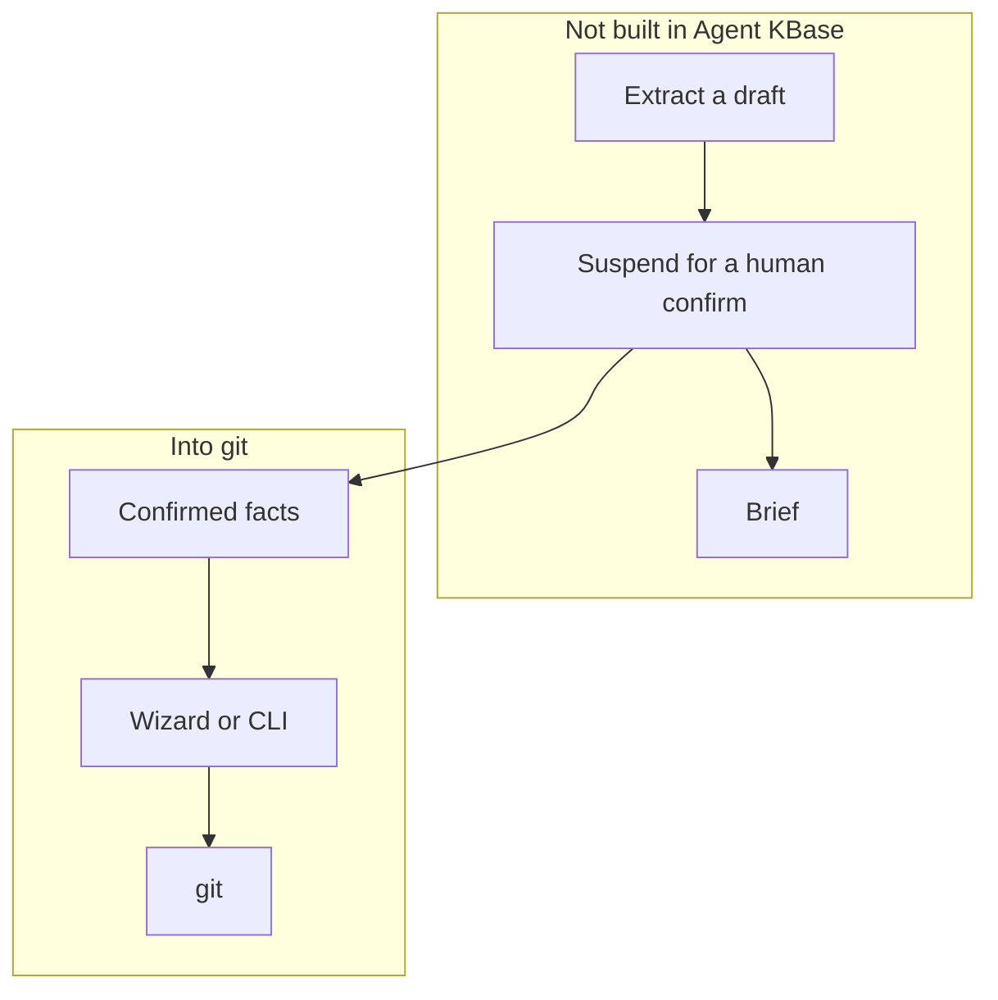

# Mastra agent + Agent KBase

A Mastra agent that reads a local `brain/` through `@agentkbase/mcp`. The server is read-only. Git stays the write path.

This folder is outside the pnpm workspace. `pnpm install` at the repository root does not install Mastra.

## Run

From this directory:

```bash
npm install
BRAIN_DIR=../fictional-saas-brain npx mastra dev
```

`BRAIN_DIR` is the repo root that contains `brain/`, not the `brain/` folder itself.

`src/mcp/agentkbase.ts` uses `packages/mcp/dist/index.js` when that build exists, and `npx -y @agentkbase/mcp` otherwise. Build the server first, from the repository root: `pnpm --filter @agentkbase/mcp build`.

## What the agent is allowed to do

`listTools()` returns `brain_brief`, `brain_search`, `brain_read`, `brain_list`, `brain_open_questions`, `brain_validate`, and `brain_eval`. The agent answers from the brief, quotes `[CONFIRM]` gaps, and refuses a price that is not in the facts. `brain_eval` checks that. Nothing here writes `brain/` or publishes.

## Review replies

`src/reviews/reply-loop.ts` reads a review and the brief. A calm review becomes a short draft made from brief lines. A 1- or 2-star review, a hostile review, or a review that needs a price, a client, or a date that is not in the folder escalates. The gap is marked `[CONFIRM]`. When `brain_eval` reports an invented price, the result escalates. The eval tool stays read-only.

`src/google/business-profile.ts` lists reviews and posts one reply:

```text
GET https://mybusiness.googleapis.com/v4/accounts/{accountId}/locations/{locationId}/reviews
PUT https://mybusiness.googleapis.com/v4/accounts/{accountId}/locations/{locationId}/reviews/{reviewId}/reply
```

The PUT body is `{ "comment": "<draft>" }`. `runReview(review, { approved })` calls that PUT only when the status is `draft` and `approved` is `true`. An escalate does not call it. A draft without that yes does not call it. Missing `GOOGLE_BUSINESS_ACCESS_TOKEN`, `GOOGLE_BUSINESS_ACCOUNT_ID`, or `GOOGLE_BUSINESS_LOCATION_ID` returns `posted: false` and does not call Google.

Google has to approve Business Profile API access for the Cloud project, and the location owner has to connect the location. The access token stays in the environment. This folder does not start an OAuth flow and does not store a token.

The sample test uses fixtures. It does not call a model or Google:

```bash
node --test test/review-loop.test.ts
```

To run the same three reviews through the Mastra MCP client and the local server, against `examples/fictional-saas-brain`:

```bash
npm run try:local
```

That path reads the real brief and `brain_eval`. It does not call a model and it does not post to Google. The chat agent still needs `OPENAI_API_KEY` (or `MASTRA_MODEL` plus that provider's key) before `npx mastra dev` can answer.

`src/mcp/read-brain.ts` loads `brain_brief` and `brain_eval` through the existing MCP client. `BRAIN_DIR` is required for that path, same as the agent.

## Flow

The agent reads through MCP. The wizard or the CLI writes `brain/` and commits. Mastra does not store the brain.



A person asks. The agent calls `brain_brief`. The server reads the pack under `BRAIN_DIR`.



The confirm loop below is the one this product describes. It is not built in this example. Confirmed facts go through the wizard or the CLI into git.


